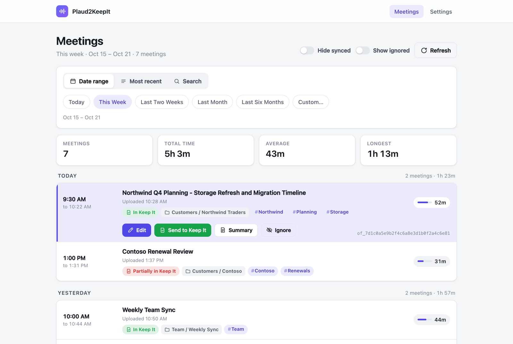
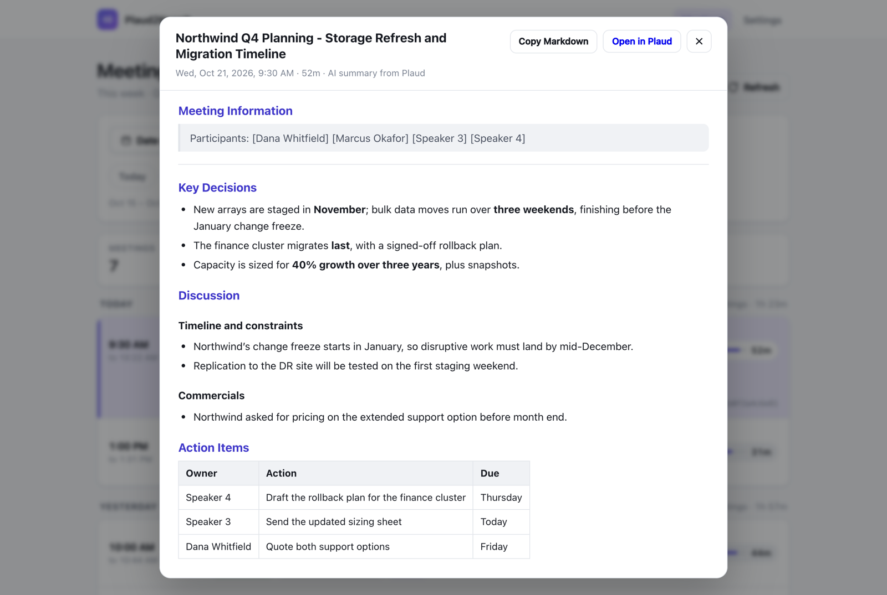
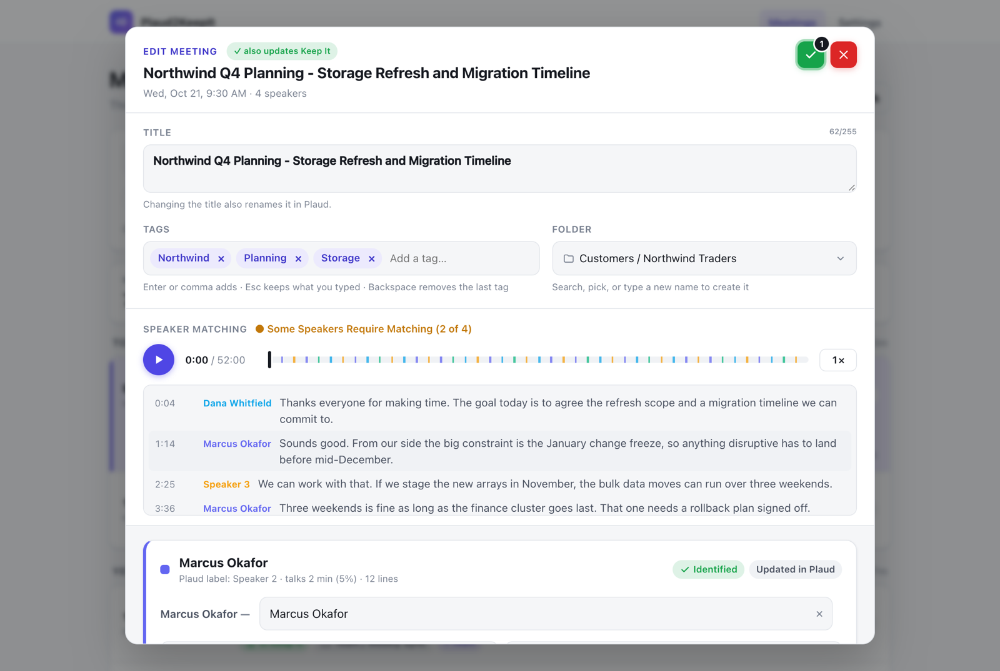
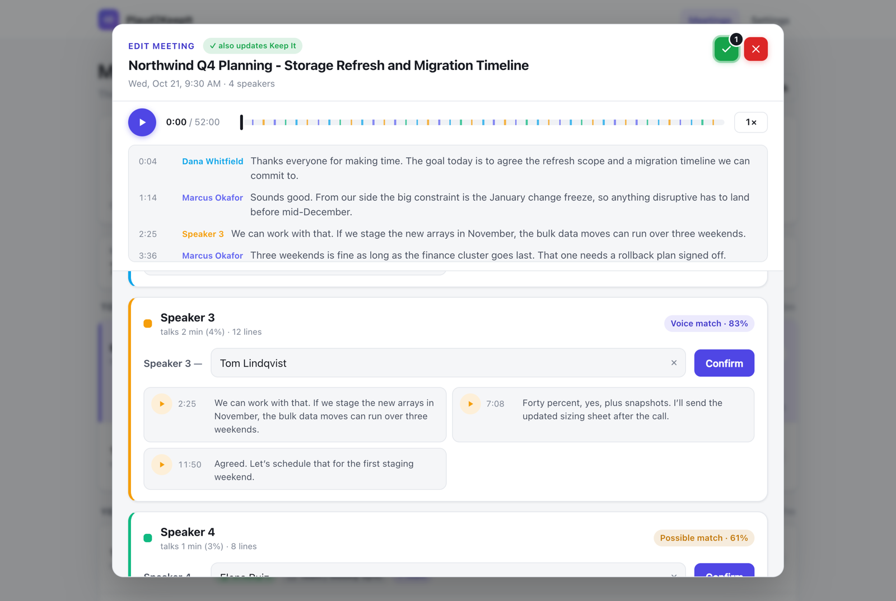
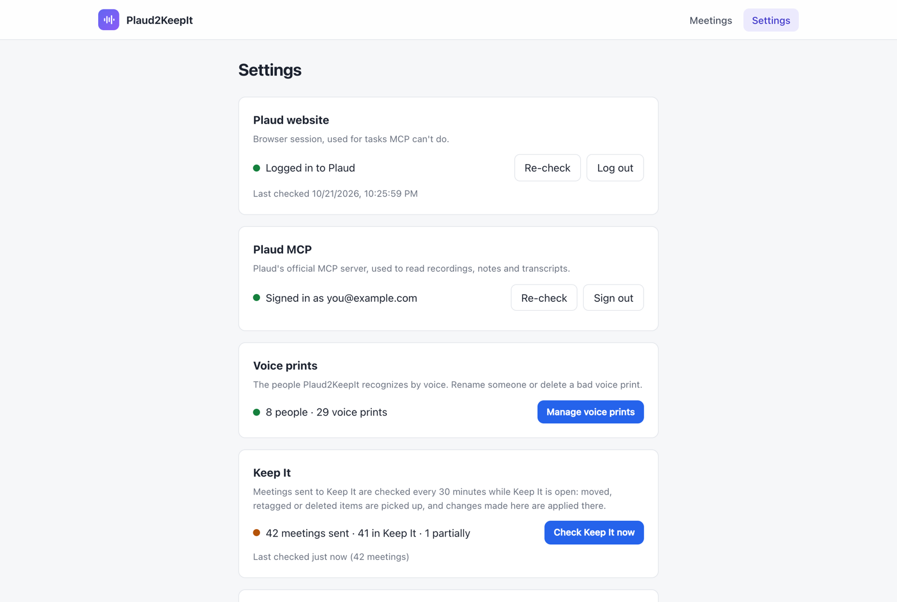
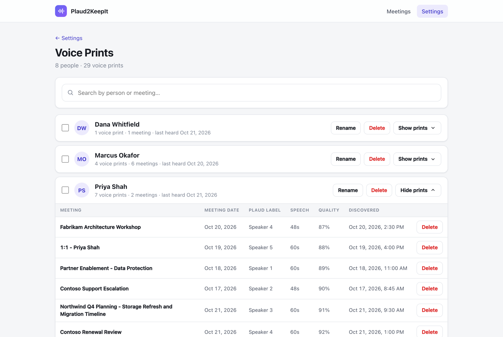
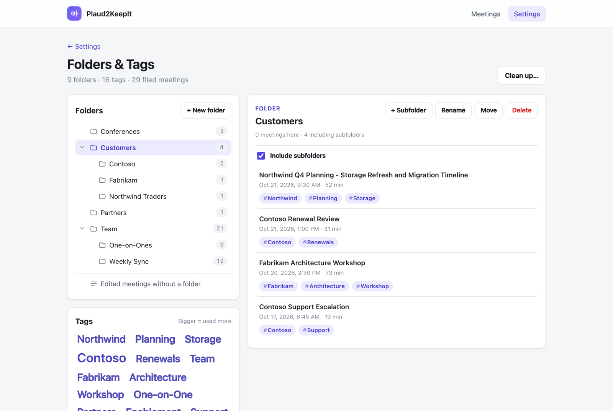

# Plaud2KeepIt

A small web app that runs on your Mac and gets your **[Plaud](https://www.plaud.ai/) meeting recordings into [Keep It](https://reinventedsoftware.com/keepit/)**, organized and with real names on the speakers.



<sub>Screenshots show made-up meetings and people.</sub>

For each meeting you can:

- **Identify speakers by voice.** Plaud labels people "Speaker 1", "Speaker 2"… Plaud2KeepIt builds a voice print for each person you name and recognizes them automatically in later meetings. Names are written back to Plaud, so its transcript and AI summary use them too.
- **Edit the title, add tags, and file it in nested folders** (Plaud's own folders can't nest).
- **Send it to Keep It** as up to four items, filed in the meeting's folder with its tags and dated to when the meeting happened:
  - **Summary**: Plaud's AI summary as a formatted note, with the infographic and any photos you took while recording, in place
  - **Transcript**: a note with speaker names (color-coded) and timestamps
  - **Mind Map**: a PNG drawn from the summary, like Plaud's mind map
  - **Highlights**: the moments you flagged while recording, each with its time and photo (only for meetings that have them)
- **Stay in step with Keep It, both ways.** Move or retag items in Keep It and the app follows; rename a tag or folder in the app and Keep It follows. Deleted items show up as **Partially in Keep It**, and a resend fills in only what's missing.

> [!WARNING]
> **Never expose Plaud2KeepIt to the Internet or your network.** It has **no login and no security of any kind**. Anyone who can reach its port can read your recordings and transcripts, rename things in your Plaud account, see your voice prints, and add or change items in Keep It.
>
> By default it only listens on your own Mac (`127.0.0.1:40000`). Don't change `HOST`, don't port-forward it, and don't put it behind a tunnel or reverse proxy.

---

## Contents

- [Requirements](#requirements)
- [Installation](#installation)
- [First-time sign-in](#first-time-sign-in)
- [Running it in the background](#running-it-in-the-background-recommended)
- [Using Plaud2KeepIt](#using-plaud2keepit)
- [How it works](#how-it-works)
- [Configuration](#configuration)
- [Your data and privacy](#your-data-and-privacy)
- [Troubleshooting](#troubleshooting)
- [Limitations](#limitations)
- [Uninstalling](#uninstalling)
- [Updating the screenshots](#updating-the-screenshots)
- [License](#license)

---

## Requirements

| What | Details |
|---|---|
| **A Mac** | macOS on Apple silicon or Intel. Keep It is Mac-only, and the app uses built-in macOS tools (AppleScript, `textutil`, `sips`, LaunchAgents). |
| **Node.js 22.13 or newer** | Includes `npm`. Node 24 is what it's developed on. 22.13 is the minimum because the database uses Node's built-in `node:sqlite`. Install from [nodejs.org](https://nodejs.org/), Homebrew (`brew install node`) or [nvm](https://github.com/nvm-sh/nvm). |
| **Git** | To clone the repository (comes with the Xcode Command Line Tools: `xcode-select --install`). |
| **A Plaud account** | With recordings, and access to the Plaud web app at [web.plaud.ai](https://web.plaud.ai) (you sign in to it once, in a browser window the app opens). AI summaries, highlights and infographics are whatever your Plaud plan produces; the app uses what's there. |
| **Keep It, licensed** | [Keep It by Reinvented Software](https://reinventedsoftware.com/keepit/), installed in `/Applications`. It must be **open** for sending and syncing (the app never launches it on its own). |
| **macOS Automation permission** | The first time the app talks to Keep It, macOS asks whether to allow controlling **Keep It**. Click **OK**. (You can change it later in System Settings → Privacy & Security → Automation.) |
| **Disk space** | About **650 MB** for dependencies (mostly Puppeteer's Chrome, ~570 MB, in `~/.cache/puppeteer`), plus the speaker model (~26 MB). Meetings you open in the editor cache their audio in `data/audio` (about 50 MB per 25-minute meeting). |
| **Internet access** | To Plaud (`plaud.ai`, its file storage on Amazon S3), and to GitHub once, to download the speaker model. |

### What gets installed

`npm install` pulls these packages (see [`package.json`](package.json)):

| Package | Used for |
|---|---|
| [`express`](https://expressjs.com/) | The local web server |
| [`@plaud-ai/mcp`](https://www.npmjs.com/package/@plaud-ai/mcp) + [`@modelcontextprotocol/sdk`](https://www.npmjs.com/package/@modelcontextprotocol/sdk) | Plaud's official MCP server, run locally, for recordings, summaries, transcripts and highlights |
| [`puppeteer`](https://pptr.dev/) | A headless Chrome for the Plaud website: your login session, and the fallback for edits |
| [`sherpa-onnx-node`](https://github.com/k2-fsa/sherpa-onnx) | Runs the speaker-recognition model that makes voice prints |
| [`ogg-opus-decoder`](https://www.npmjs.com/package/ogg-opus-decoder) | Decodes Plaud's audio (WebAssembly, no ffmpeg needed) |
| [`marked`](https://marked.js.org/) | Markdown → formatted notes |
| [`markmap-view`](https://markmap.js.org/) + [`d3`](https://d3js.org/) | Drawing mind maps |

`npm run setup` then downloads the speaker model, **3D-Speaker ERes2Net (English, VoxCeleb)** from the [sherpa-onnx releases](https://github.com/k2-fsa/sherpa-onnx/releases/tag/speaker-recongition-models), into `models/`, and makes sure Puppeteer's Chrome is installed.

---

## Installation

```bash
git clone https://github.com/sglewis100/Plaud2KeepIt.git
cd Plaud2KeepIt
npm install
npm run setup
npm start
```

Then open **http://localhost:40000** in your browser.

> `npm install` may warn that some packages' install scripts were skipped. That's expected; `npm run setup` takes care of what matters (Puppeteer's Chrome).

---

## First-time sign-in

Open **Settings** (top right). There are two Plaud connections, and both are needed:

1. **Plaud website**: click **Log in to Plaud**. A normal Chrome window opens on Plaud's sign-in page. Sign in however you usually do (email, Google, Apple or SSO). The window closes itself once you're in, and the card turns green. The login is kept in `.chrome-profile/`, so this is a one-time step until Plaud signs you out.
2. **Plaud MCP**: click **Sign in**. Plaud's authorization page opens in your default browser; click **Authorize**. The card shows "Signed in as …".

Then open Keep It (and allow the Automation prompt when it appears on your first send).

If either sign-in lapses later, a yellow banner at the top of the Meetings, Folders & Tags and Voice prints pages says so, with a **Sign in** button that starts the same process; no need to go to Settings.

---

## Running it in the background (recommended)

Instead of keeping a terminal open, install it as a macOS LaunchAgent. It starts when you log in, restarts itself if it ever stops, and reloads automatically when the code changes:

```bash
npm run service:install
```

| Command | What it does |
|---|---|
| `npm run service:install` | Install (or reinstall) and start the background service |
| `npm run service:status` | Is it running? |
| `npm run service:restart` | Restart it |
| `npm run service:logs` | Follow the log (`logs/server.log`) |
| `npm run service:uninstall` | Stop and remove the service |

The service uses the `node` on your `PATH` when you install it. If you switch Node versions or move the folder, run `npm run service:install` again. Don't run `npm start` while the service is running, since both use port 40000.

---

## Using Plaud2KeepIt

### Meetings

The home page lists your Plaud recordings: start and end time, length, when it was uploaded, its folder, tags and Keep It status, grouped by day.

- **Date range**: Today, This Week (the last 7 days), Last Two Weeks, Last Month, Last Six Months, or a custom range.
- **Most recent**: the last 10, 25, 50, 100, 250, or any number up to 500.
- **Search**: by meeting name. Plaud searches your newest 500 recordings.
- **Hide synced**: hides meetings that are fully in Keep It (partially synced ones stay visible).
- **Show ignored**: shows meetings you've ignored, dimmed with an **Ignored** badge. Off by default.

Click a meeting to select it, then use **Edit**, **Send to Keep It**, **Summary**, or **Ignore**. **Summary** shows Plaud's AI summary, formatted, with **Copy Markdown** and **Open in Plaud** (images in the summary are only viewable in Plaud). **Ignore** hides a meeting you don't want to import (a test recording, a personal call); turn on **Show ignored** to find it again and click **Un-ignore**. Ignoring only affects this app's list: nothing changes in Plaud or Keep It. The recording ID appears at the bottom right of a selected meeting; click it to copy.

Badges on each meeting: green **In Keep It**, red **Partially in Keep It** (hover to see what's missing), or the step it's on while sending.



### Edit (title, tags, folder and speakers)

One dialog for everything about a meeting:



- **Title**: changing it also renames the recording in Plaud, and the meeting's items in Keep It. Titles become file names in Keep It, so if a title contains characters macOS can't use in a file name, the dialog suggests a safe version when it opens (`:` and `/` become `-` or ` - `, `\` likewise, and a leading `.` is dropped). It's saved only when you click ✓, and **Undo** puts the original back.
- **Tags**: type and press Enter or comma. Suggestions come from your existing tags: the top match is highlighted, so Enter picks it; press **Esc** to keep exactly what you typed instead.
- **Folder**: search your folder tree, pick one, or type a new name (or a path like `Clients / Acme`) and choose **Create**.
- **Player and transcript**: play the meeting with the transcript following along; click any line to jump there.
- **Speakers**: a card for each Plaud speaker label, with talk time and eight short listening samples. Type a name, or accept the suggestion:
  - **Voice match** (green, 70% or higher similarity): very likely the same person. Prefilled with **Confirm**.
  - **Possible match** (yellow, 55–70%): listen first; needs its own Confirm.
  - Two labels that sound alike are flagged: Plaud sometimes splits one person into two.
  - Saving a name that already exists asks whether it's the **same person (Merge)** or **someone else with the same name (Save as new)**. Different people keep separate voice prints.
  - **✕** in a name box clears it. For a saved name (or one Plaud shows), ✓ removes it here, drops the voice print it added, and puts Plaud's own "Speaker N" label back.



The green **✓** saves everything (details and names), then updates Plaud: the title, and the speaker names in the transcript and AI summary. If the meeting is already in Keep It and you renamed speakers, the ✓ shows **"also updates Keep It"**, and the meeting's items are rebuilt with the new names. The dialog then closes; Plaud keeps updating in the background, even if some speakers are still unnamed. Closing with unsaved changes asks first.

### Send to Keep It

Before sending it checks:

1. **Unnamed speakers** ("Speaker 1" and so on) → **Cancel**, **Send to Keep It** anyway, or **Name Speakers**.
2. **No tags or no folder** → pick them, then **Save & Send to Keep It**.

Then it builds and sends the items, showing each step on the meeting. Only what's **missing** from Keep It is sent. If everything is already there, you're offered **Rebuild in Keep It**, which replaces the items with fresh copies (for example after Plaud regenerated a summary). Replaced items go to Keep It's **Deleted Items**.

**Folders**: the app's folder path maps onto Keep It's folders from the top level, and missing levels are created. `Clients / Acme` goes in Keep It's top-level `Clients` folder, in a subfolder `Acme`.

### Keeping Keep It in step

Every meeting you've sent is checked against Keep It **every 30 minutes** while Keep It is open (and when you click **Check Keep It now** in Settings). The app remembers the last state both sides agreed on, so it knows which side changed:

| Change | Result |
|---|---|
| You move or retag items **in Keep It** | The meeting's folder and tags follow in the app |
| You change a meeting's folder, tags or title **in the app**, or rename or delete a tag or folder | Keep It's items are moved, retagged or renamed to match |
| Tags changed on **both** sides | Additions and removals from each are combined |
| Folder changed on **both** sides | Keep It wins (it's logged) |
| Items deleted in Keep It | The meeting becomes **Partially in Keep It** (or loses its badge if everything's gone); **Send to Keep It** restores just those |

Only Plaud2KeepIt's own items are ever touched, never your other Keep It content.

### Settings

- **Plaud website**: log in or out (for title and speaker updates, and images).
- **Plaud MCP**: sign in or out (for recordings, summaries and transcripts).
- **Voice prints**: everyone the app recognizes. Search by person or meeting, **rename** someone (optionally in Plaud too), **delete** a single voice print, **delete a person** with all their voice prints (names already written to Plaud stay there), or tick two or more people to **merge** them (with a check of whether their voices actually match). Each person keeps at most 10 voice prints; the most redundant are dropped, so the ones kept cover the widest range of conditions.
- **Keep It**: how many meetings are fully, partially, or no longer in Keep It, when it last checked, and **Check Keep It now**.
- **Folders & tags**: the folder tree (new, rename, move, delete) and a tag cloud (rename, merge, delete). Selecting either lists its meetings. **Clean up…** removes tags no meeting uses and folders with no meetings in them, after showing you the list.







Folders and tags are the app's own organization. Erasing Keep It doesn't remove them, so if you start over, delete them here, or use **Clean up…** once no meeting uses them.

---

## How it works

| Need | Source |
|---|---|
| Recordings, summaries, transcripts, highlights | **Plaud MCP**: Plaud's official MCP server, run locally |
| Images (infographic, your photos) | Plaud's **web API**, as the Plaud website uses it (unofficial) |
| Renaming titles and speakers in Plaud | Plaud's **web API**, with the same requests the Plaud website sends. If it fails, the app falls back to doing the same thing on the Plaud website in a hidden Chrome window. |
| Your Plaud web session | Headless Chrome (Puppeteer) with the profile you signed in to |
| Voice prints | A speaker-recognition model (ERes2Net) run **on your Mac** by sherpa-onnx, on about 60 seconds of each speaker's clearest speech |
| Notes in Keep It | Markdown → formatted HTML → rich text with images embedded (macOS `textutil`) → imported as Keep It notes |
| Mind maps | The summary's outline drawn with markmap (the same library Plaud uses) in headless Chrome |
| Keep It | AppleScript |
| Your data | A local SQLite database (`data/plaud2keepit.db`) |

Plaud's AI summaries update speaker names the way Plaud's own app does (its replacement rules are mirrored exactly), so names you set here show up in Plaud too.

---

## Configuration

Set these as environment variables when starting (for example `PORT=41000 npm start`). For the background service, add them to the `EnvironmentVariables` section of `service/com.plaud2keepit.server.plist.template` and reinstall.

| Variable | Default | What it does |
|---|---|---|
| `PORT` | `40000` | Web server port |
| `HOST` | `127.0.0.1` | Address to listen on. **Leave it**; see the warning at the top. |
| `DATA_DIR` | `./data` | Where the database and audio cache live |
| `CHROME_PROFILE_DIR` | `./.chrome-profile` | Browser profile holding your Plaud website login |
| `CHROME_PATH` | Puppeteer's Chrome | Use a different Chrome/Chromium |
| `HEADLESS` | `true` | `false` shows the automation browser window (for debugging) |
| `LOGIN_DEBUG_PORT` | `40222` | Local port used to watch the login window |

Plaud MCP's own sign-in uses a local callback on port `8199` while you authorize.

---

## Your data and privacy

Everything stays on your Mac, apart from what goes to Plaud and Keep It themselves.

| Location | Contents |
|---|---|
| `data/plaud2keepit.db` | People, voice prints, speaker assignments, titles, tags, folders, ignored meetings, Keep It sync state |
| `data/audio/` | Cached meeting audio (for playback and voice prints). Safe to delete; it's re-downloaded when needed. |
| `.chrome-profile/` | Your logged-in Plaud web session. **Treat it like a password.** |
| `~/.plaud/tokens-mcp.json` | Plaud MCP's sign-in (created by Plaud's MCP package, shared with other Plaud MCP clients on this Mac) |
| `logs/server.log` | Server log (when running as a service) |

All of these are excluded from git.

- **Telemetry is off.** Plaud MCP runs with its usage telemetry disabled (`DO_NOT_TRACK=1`, `PLAUD_TELEMETRY_DISABLED=1`), and the Plaud website's analytics and trackers are blocked in the app's browser.
- **Voice prints never leave your Mac.** They're computed locally.

---

## Troubleshooting

**Keep It freezes (spinning beach ball) and needs a force quit**
Keep It can deadlock if a scripted request arrives while it's saving in the background, especially when its library syncs through iCloud Drive or another cloud folder. Plaud2KeepIt keeps requests few and spaced out, waits after every change, and stops if Keep It doesn't answer within 25 seconds. Settings then shows **Keep It isn't responding** and background checks pause for 15 minutes. Force-quit Keep It (⌥⌘⎋), reopen it, then click **Check Keep It now**.

**Plaud MCP says "429 Too Many Requests"**
Plaud rate-limits its MCP server. Wait a few minutes. Normal use is well under the limit; very large back-to-back searches can hit it.

**Titles or speaker names aren't updating in Plaud**
Check that **Plaud website** in Settings is logged in. Updates use your web session (API first, then the website itself). On failure, the meeting shows the error, and a screenshot is saved in `.debug/`.

**A name I just set doesn't show up yet**
Plaud MCP lags a few seconds behind changes. The app waits for it before rebuilding Keep It items.

**Audio plays from the wrong spot (Safari)**
Fixed by design: playback uses a WAV made from the decoded audio, because Plaud's Ogg files make some browsers seek about 7% off.

**Nothing happens when sending to Keep It**
Make sure Keep It is open, and that the app is allowed to control it (System Settings → Privacy & Security → Automation).

**`Error: Cannot find module … sherpa-onnx`, or voice prints fail**
Run `npm install` again on the Mac you're using (the package includes native code for Apple silicon and Intel), then `npm run setup` for the model.

**Port 40000 is already in use**
Another copy is probably running. Check `npm run service:status`, or start with a different `PORT`.

---

## Limitations

- **Unofficial Plaud API.** Image downloads and title/speaker updates use the same requests the Plaud website makes. Plaud can change them at any time. The website fallback covers renames, and MCP covers everything else.
- **Keep It item titles don't flow back.** Renaming an item in Keep It doesn't rename the meeting. The next sync puts back the standard name.
- **Note headings keep the old title** after a title change, until the meeting is rebuilt (rebuilding replaces the note, which would discard anything you added to it in Keep It).
- **Polished transcripts** in Plaud sometimes use their own AI-chosen speaker names, which aren't renamed.
- **One Mac, one user.** It isn't designed to be shared.
- **English voice model.** Voice matching is tuned for English speech.

This project isn't affiliated with or endorsed by PLAUD Inc. or Reinvented Software. Plaud and Keep It are trademarks of their respective owners.

---

## Uninstalling

```bash
npm run service:uninstall
```

Then:

1. Sign out of **Plaud MCP** in Settings first, if you want its authorization revoked.
2. Delete the project folder (this removes your database, voice prints, cached audio and Plaud web login).
3. Optionally remove Puppeteer's Chrome, if nothing else uses it: `rm -rf ~/.cache/puppeteer`
4. Optionally remove Plaud MCP's sign-in, if no other app uses it: `rm ~/.plaud/tokens-mcp.json`

Items already sent to Keep It stay there.

---

## Updating the screenshots

The screenshots in `docs/screenshots/` come from a mock server with made-up meetings and people (`scripts/screenshots/mock-server.js`), so they never show real recordings. After changing the UI, retake them:

```bash
npm run screenshots
```

Add `-- dark` for dark mode. Your own Plaud session, Keep It and data aren't touched.

---

## License

[MIT](LICENSE) © 2026 Scott Lewis. Use it, change it and share it freely; it comes with no warranty.
